### Solar 나무 우주선 — MIT 우주선 모델 (GLB)
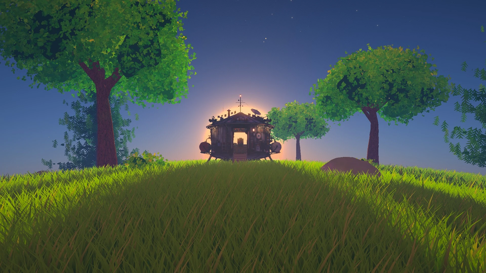
- 파일: `solar-ship/solar-ship.zip` (12.8MB, GLB 1개 + 라이트맵 WebP 4종 + Blender 빌드 스크립트 9개 + LICENSE.txt)
- 제작: Patch (@blendi) / 라이선스: MIT / 원본: https://patch.gg/games/blendi/solar
- 비고: 원작이 Blender 스크립트로 만든 자작 디자인(네 다리 나무 오두막 우주선, 내부 조종석 포함). GLB는 meshopt 압축(three meshopt 디코더 필요). 미리보기는 원작 공식 스크린샷
### anymove Knight — CC0 애니메이션 크리처 (GLB)

- 파일: `releases/download/anymove/anymove-knight.zip` (8.5MB, GLB 1개 + CC0 전문 + CREDITS.txt) — Releases 첨부
- 제작: Patch (@patch_gg) / 라이선스: CC0 / 원본: https://patch.gg/create/toolbox/assets/anymove:knight
- 비고: anymove(AI 모션캡처) 제작. 리깅+애니메이션 9클립(Idle/Walk/Run/Attack/Hit/Jump/Kick 등), 59,281 tris. 릴리스: [anymove](https://github.com/sigco3111/assets-3d-lowpoly-2/releases/tag/anymove)

### anymove T-Rex — CC0 애니메이션 크리처 (GLB)

- 파일: `releases/download/anymove/anymove-trex.zip` (8.2MB, GLB 1개 + CC0 전문 + CREDITS.txt) — Releases 첨부
- 제작: Patch (@patch_gg) / 라이선스: CC0 / 원본: https://patch.gg/create/toolbox/assets/anymove:trex
- 비고: anymove(AI 모션캡처) 제작. 리깅+애니메이션 9클립(Roar 포함), 57,914 tris. 릴리스: [anymove](https://github.com/sigco3111/assets-3d-lowpoly-2/releases/tag/anymove)

### anymove Mech — CC0 애니메이션 크리처 (GLB)

- 파일: `releases/download/anymove/anymove-mech.zip` (7.3MB, GLB 1개 + CC0 전문 + CREDITS.txt) — Releases 첨부
- 제작: Patch (@patch_gg) / 라이선스: CC0 / 원본: https://patch.gg/create/toolbox/assets/anymove:mech
- 비고: anymove(AI 모션캡처) 제작. 리깅+애니메이션 9클립(Stomp 포함), 55,813 tris. 릴리스: [anymove](https://github.com/sigco3111/assets-3d-lowpoly-2/releases/tag/anymove)

### anymove Ogre — CC0 애니메이션 크리처 (GLB)

- 파일: `releases/download/anymove/anymove-ogre.zip` (7.4MB, GLB 1개 + CC0 전문 + CREDITS.txt) — Releases 첨부
- 제작: Patch (@patch_gg) / 라이선스: CC0 / 원본: https://patch.gg/create/toolbox/assets/anymove:ogre
- 비고: anymove(AI 모션캡처) 제작. 리깅+애니메이션 8클립(GroundSlam 포함), 59,464 tris. 릴리스: [anymove](https://github.com/sigco3111/assets-3d-lowpoly-2/releases/tag/anymove)

### anymove Scorpion — CC0 애니메이션 크리처 (GLB)

- 파일: `releases/download/anymove/anymove-scorpion.zip` (7.6MB, GLB 1개 + CC0 전문 + CREDITS.txt) — Releases 첨부
- 제작: Patch (@patch_gg) / 라이선스: CC0 / 원본: https://patch.gg/create/toolbox/assets/anymove:scorpion
- 비고: anymove(AI 모션캡처) 제작. 리깅+애니메이션 4클립, 57,077 tris. 릴리스: [anymove](https://github.com/sigco3111/assets-3d-lowpoly-2/releases/tag/anymove)

### anymove Giant Ape — CC0 애니메이션 크리처 (GLB)

- 파일: `releases/download/anymove/anymove-ape.zip` (9.4MB, GLB 1개 + CC0 전문 + CREDITS.txt) — Releases 첨부
- 제작: Patch (@patch_gg) / 라이선스: CC0 / 원본: https://patch.gg/create/toolbox/assets/anymove:ape
- 비고: anymove(AI 모션캡처) 제작. 리깅+애니메이션 6클립(ChestBeat 포함), 57,778 tris. 릴리스: [anymove](https://github.com/sigco3111/assets-3d-lowpoly-2/releases/tag/anymove)

### anymove Centaur — CC0 애니메이션 크리처 (GLB)

- 파일: `releases/download/anymove/anymove-centaur.zip` (6.3MB, GLB 1개 + CC0 전문 + CREDITS.txt) — Releases 첨부
- 제작: Patch (@patch_gg) / 라이선스: CC0 / 원본: https://patch.gg/create/toolbox/assets/anymove:centaur
- 비고: anymove(AI 모션캡처) 제작. 리깅+애니메이션 9클립(Rear 포함), 59,615 tris. 릴리스: [anymove](https://github.com/sigco3111/assets-3d-lowpoly-2/releases/tag/anymove)

### anymove Horse — CC0 애니메이션 크리처 (GLB)

- 파일: `releases/download/anymove/anymove-horse.zip` (5.7MB, GLB 1개 + CC0 전문 + CREDITS.txt) — Releases 첨부
- 제작: Patch (@patch_gg) / 라이선스: CC0 / 원본: https://patch.gg/create/toolbox/assets/anymove:horse
- 비고: anymove(AI 모션캡처) 제작. 리깅+애니메이션 7클립, 59,202 tris. 릴리스: [anymove](https://github.com/sigco3111/assets-3d-lowpoly-2/releases/tag/anymove)

### anymove Woman — CC0 애니메이션 크리처 (GLB)

- 파일: `releases/download/anymove/anymove-woman.zip` (5.3MB, GLB 1개 + CC0 전문 + CREDITS.txt) — Releases 첨부
- 제작: Patch (@patch_gg) / 라이선스: CC0 / 원본: https://patch.gg/create/toolbox/assets/anymove:woman
- 비고: anymove(AI 모션캡처) 제작. 리깅+애니메이션 6클립(Kick 포함), 57,274 tris. 릴리스: [anymove](https://github.com/sigco3111/assets-3d-lowpoly-2/releases/tag/anymove)

### AbilityCasting 상어·드래곤·자이로스코프 모델·환경 텍스처 (권리 미확인)
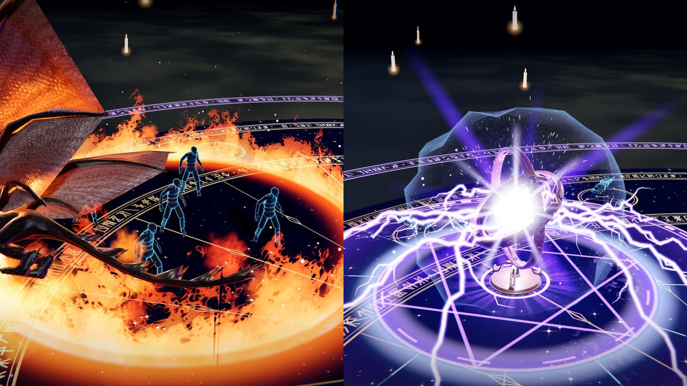
- 파일: `abilitycasting-unverified/abilitycasting-unverified.zip` (20MB, GLB 3개 + 텍스처 10개 + CREDITS + README.txt) — 저장소 내 포함
- 제작: mohamedachrefelouafi (서드파티 원권리자 불명) / 라이선스: 알 수 없음 / 원본: https://github.com/achrefelouafi/AbilityCastingThreeJS
- 비고: 재사용 허락 미확인(사용 전 원권리자 확인 필요, 권리자 요청 시 즉시 내림). shark는 Blender 메타·전용 클립뿐인 정황, dragon·gyroscope는 Sketchfab 다운로드 메타, cathedral PBR·배너·스테인드글라스·룬 텍스처는 출처 미확인. Mixamo FBX·diffuse.png는 명시적 재배포 금지로 미수록

### AbilityCasting 결투장·생물·소품 3D 모델 5종 (GLB)
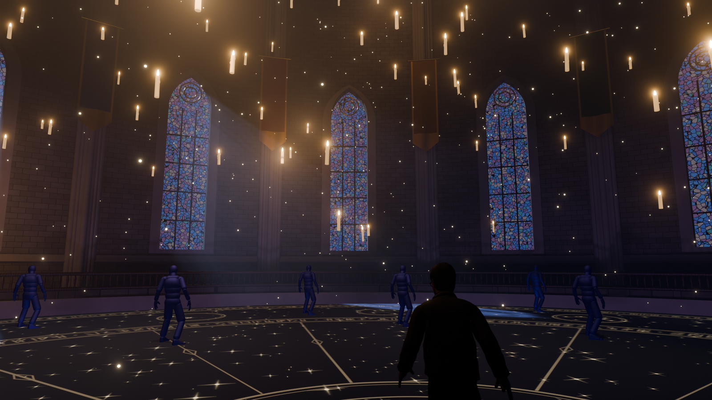
- 파일: `releases/download/abilitycasting-models/abilitycasting-models.zip` (53MB, GLB 5개 + 결투장 천 텍스처 + 환경 HDRI + Blender 원본 3종 + LICENSE + CREDITS + README.txt) — Releases 첨부
- 제작: mohamedachrefelouafi / 라이선스: MIT (환경 HDRI만 Poly Haven CC0) / 원본: https://github.com/achrefelouafi/AbilityCastingThreeJS
- 비고: 원작자 자작 명시 확인분(duel_hall 환경, wolf 리그+클립 6종, arcane_tome, wildroot_reliquary, amethyst_stones)과 .blend 원본(duel_hall·day·wolf). shark·dragon·gyroscope·일부 텍스처는 권리 미확인 팩 abilitycasting-unverified, Mixamo FBX·diffuse.png(재배포 금지)는 미수록. 코드 팩은 assets-code abilitycasting-spell-vfx

### Procedural Animals 베이크 샘플 6종 (.animal)
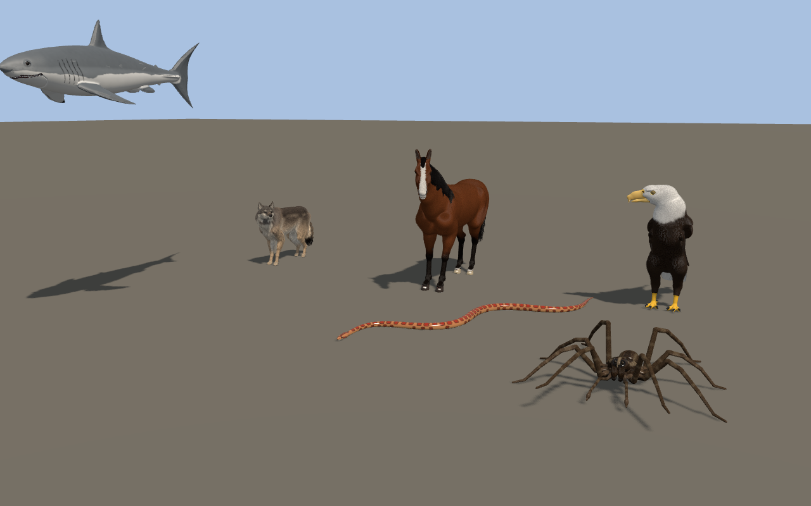
- 파일: `procedural-animal-samples/procedural-animal-samples.zip` (25MB, .animal 6개 + LICENSE + README.txt) — 저장소 내 포함
- 제작: Majid Manzarpour and procedural-animals contributors / 라이선스: MIT / 원본: https://github.com/majidmanzarpour/threejs-procedural-animals
- 비고: MIT 절차적 동물 생성기의 베이크 개체 6종(wolf·horse·eagle·shark·snake·spider, seed 3, quality high, 개체당 64,814~75,503 버텍스 — 이 저장소의 로우폴리 팩들과 달리 고정점 수). 전용 .animal 포맷(리그·스킨·애니메이션 포함, 로드에 동일 라이브러리 필요, GLB 아님). 코드 팩은 assets-code procedural-animals-threejs

### Lowpoly Tree 샘플 모델 6종 (GLB)
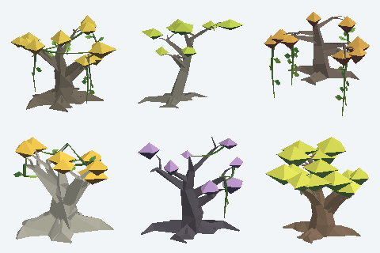
- 파일: `lowpoly-tree-samples/lowpoly-tree-samples.zip` (141KB, GLB 6개 + LICENSE + README.txt) — 저장소 내 포함
- 제작: Rand Monster contributors / 라이선스: MIT / 원본: https://github.com/pajama-studio/lowpoly-tree-generator
- 비고: MIT 생성기(lowpoly-tree-generator) 아키타입 6종 GLB(버텍스 컬러·무텍스처, 삼각형 705~1708, 덩굴 포함 4종). 코드 팩은 assets-code lowpoly-tree-generator

### Fjordfall Boats & Vehicles
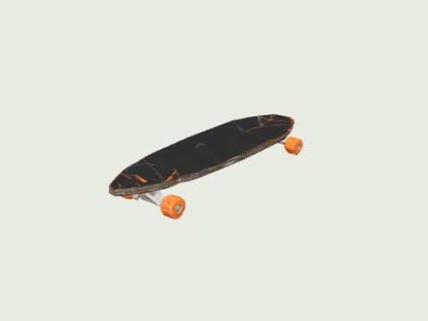
- 파일: `fjordfall-boats-and-vehicles.zip` (1.3MB) — 저장소 내 포함
- 제작: Jonathan Maddison / 라이선스: CC BY 4.0 (AI 생성, 생성 도구 Meshy·Blender) / 원본: https://github.com/AgenticGameDevs/generated-assets

### Fjordfall Buildings

- 파일: `fjordfall-buildings.zip` (1.4MB) — 저장소 내 포함
- 제작: Jonathan Maddison / 라이선스: CC BY 4.0 (AI 생성) / 원본: https://github.com/AgenticGameDevs/generated-assets

### Fjordfall Characters

- 파일: `fjordfall-characters.zip` (2.4MB) — 저장소 내 포함
- 제작: Jonathan Maddison / 라이선스: CC BY 4.0 (AI 생성) / 원본: https://github.com/AgenticGameDevs/generated-assets

### Golem Knight

- 파일: `golem.zip` (62.8KB) — 저장소 내 포함
- 제작: Q2DENJINDREW / 라이선스: CC0 / 원본: https://opengameart.org/content/golem-knight

### Painting Pack

- 파일: `paintings_textured.zip` (5.9MB) — 릴리스 첨부
- 제작: EmoPreben / 라이선스: CC0 / 원본: https://opengameart.org/content/painting-pack

수록 팩: 21팩

### Lowpoly survival item pack
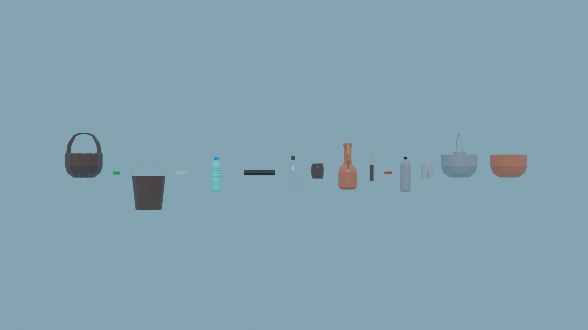
- 파일: `survival-items.zip` (279.4KB) — 저장소 내 포함
- 제작: artie31 / 라이선스: CC0 / 원본: https://opengameart.org/content/lowpoly-survival-item-pack

### LOW POLY 3D MODEL PACKS

- 파일: `model_pack_low_poly.zip` (517.6KB) — 저장소 내 포함
- 제작: byzmod3d / 라이선스: CC0 / 원본: https://opengameart.org/content/low-poly-3d-model-packs
### 3D Vehicles Pack 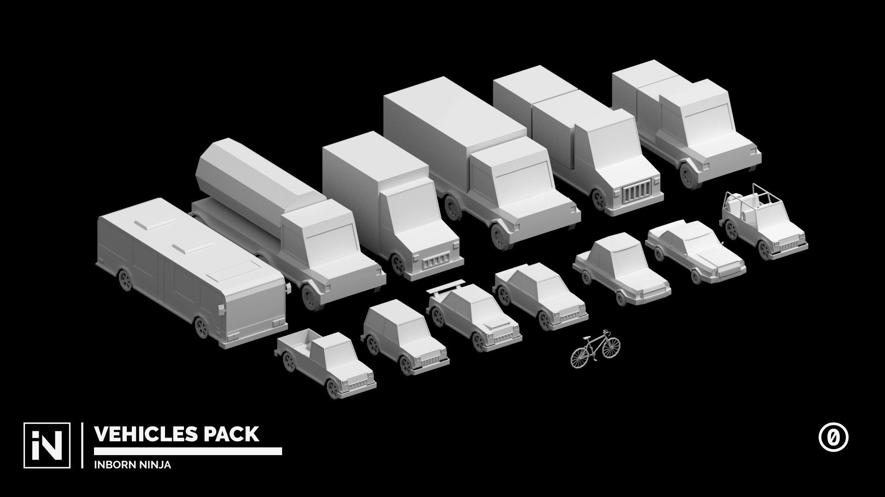
- 파일: `vehicle_pack.zip` (2.6MB) — 저장소 내 포함
- 제작: mehrasaur / 라이선스: CC0 / 원본: https://opengameart.org/content/3d-vehicles-pack
### Low Poly RPG Pack 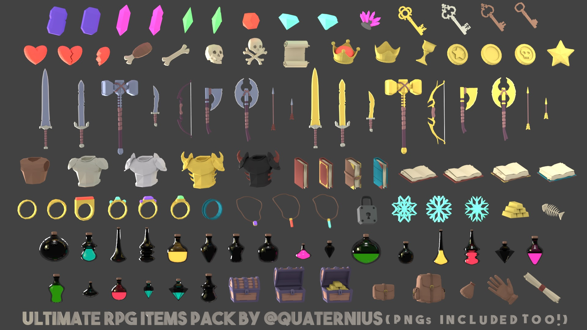
- 파일: [릴리스 v1.0 첨부 다운로드](https://github.com/sigco3111/assets-3d-lowpoly-2/releases/download/v1.0/ultimate_rpg_items_pack_by_quaternius_0.zip) (42.6MB) — 릴리스 첨부
- 제작: quaternius / 라이선스: CC0 / 원본: https://opengameart.org/content/low-poly-rpg-pack
### LowPoly Survival Pack 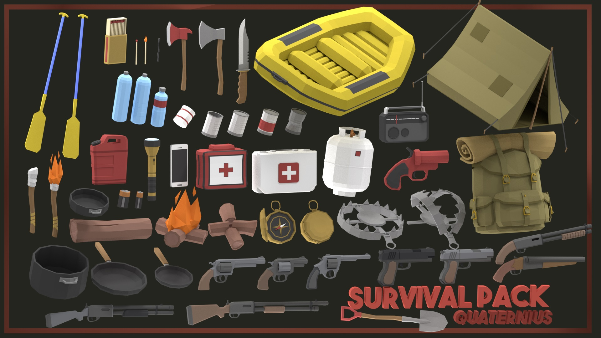
- 파일: [릴리스 v1.0 첨부 다운로드](https://github.com/sigco3111/assets-3d-lowpoly-2/releases/download/v1.0/survival_pack_-_sept_2020.zip) (5.7MB) — 릴리스 첨부
- 제작: quaternius / 라이선스: CC0 / 원본: https://opengameart.org/content/lowpoly-survival-pack

### Shadowflame Samurai (게임용 변환 바디)
- 파일: `shadowflame-samurai-game-body/7-shadowflame-samurai-game-body.zip` (4.1MB) — 저장소 내 포함
- 제작: dark_igorek / 라이선스: CC BY 4.0 / 원본: https://sketchfab.com/3d-models/shadowflame-samurai-03def921ed814b3a9de5c5962b86a45c
- 비고: Ashen Oath 인계분(i1 등록 2026-11-18), FBX→GLB 변환·텍스처 축소 적용된 게임용 바디. 표기·변경 명시 필수(팩 폴더 CREDITS.txt). 미리보기 없음. 파일명 접두 번호는 웹 업로드 방식의 한계

### The Lost Storm CC-BY 4.0 Models
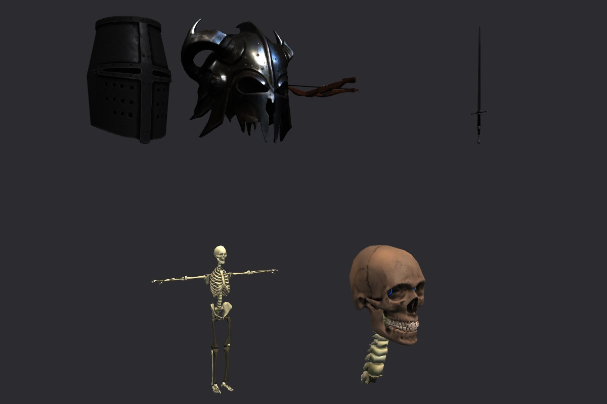
- 파일: `the-lost-storm-ccby-models/the-lost-storm-ccby-models.zip` (9.6MB) — 저장소 내 포함
- 제작: 다수(Sketchfab 헬멧 12종·무기 24종, PolyOne skeleton, martinjario skull, 100STYLE 스핀 클립) / 라이선스: CC BY 4.0 / 원본: https://github.com/sigco3111/the-lost-storm-ko
- 비고: The Lost Storm 비공식 한국어 팬 번역 프로젝트의 게임용 GLB 변형분. 항목별 귀속·원본 링크·변경 내역은 팩 폴더 CREDITS.txt / LICENSE-SOURCE.txt / CC-BY-4.0.txt. CC0(Quaternius·KayKit·Poly Pizza·Avramania) 및 자체제작 모델은 제외.

### The Lost Storm CC0 PBR Textures
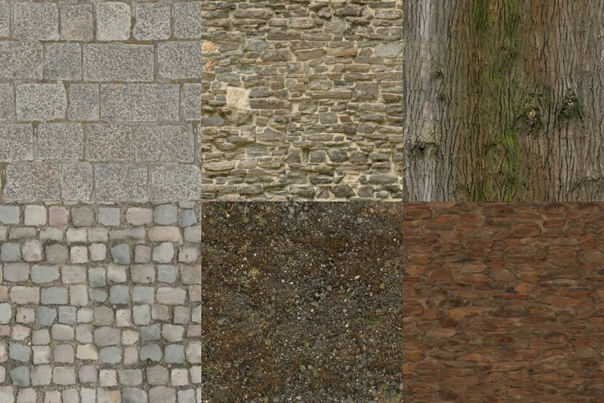
- 파일: `the-lost-storm-cc0-textures/the-lost-storm-cc0-textures.zip` (15MB) — 저장소 내 포함
- 제작: Poly Haven / 라이선스: CC0 1.0 / 원본: https://github.com/sigco3111/the-lost-storm-ko
- 비고: The Lost Storm 배포 PBR 텍스처 세트(color/normal/orm WebP + half/ 모바일 절반 해상도). 출처·저작자는 팩 폴더 LICENSE-SOURCE.txt.

### Cold Boot 할보르센 3D 머리 (MakeHuman CC0)
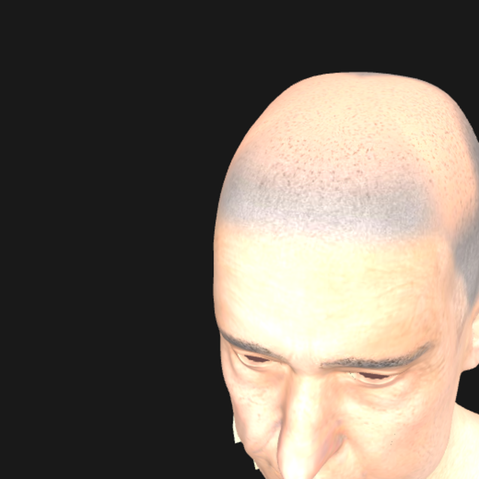
- 파일: `cold-boot-halvorsen-head.zip` (0.8MB) — 저장소 내 포함
- 제작: MakeHuman team (가공: rossinek) / 라이선스: CC0 1.0 / 원본: https://github.com/rossinek/cold-boot

### Cold Boot 토마스 3D 머리 (Lee Perry-Smith 스캔)
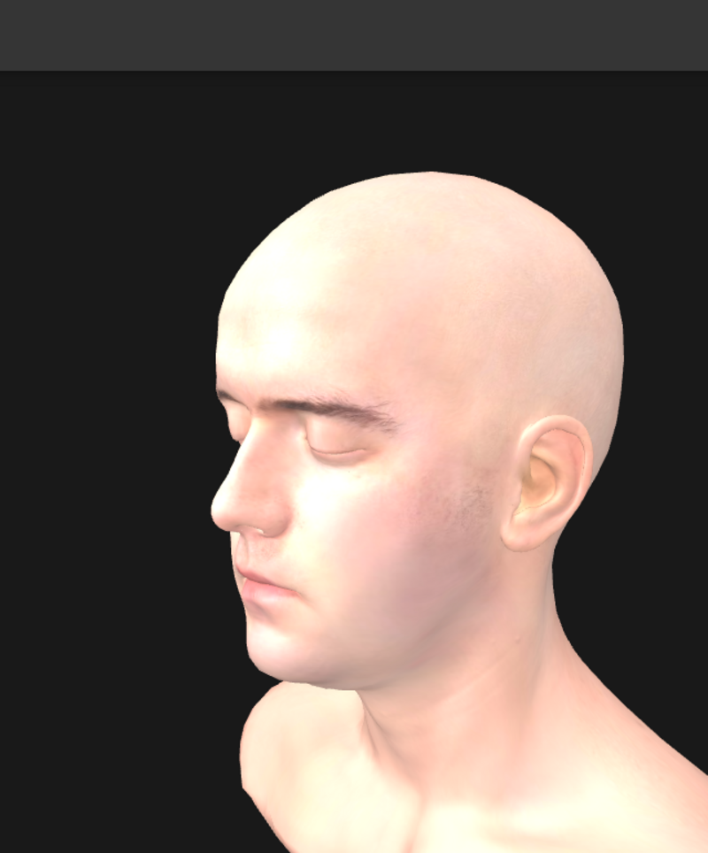
- 파일: `cold-boot-tomas-head.zip` (0.5MB) — 저장소 내 포함
- 제작: Lee Perry-Smith (Infinite Realities) / 라이선스: CC BY 3.0 (실존 인물 스캔, 초상권 별도 확인) / 원본: https://github.com/rossinek/cold-boot

### Papertrails 팝업북 3D 모델 (타일·여행자)
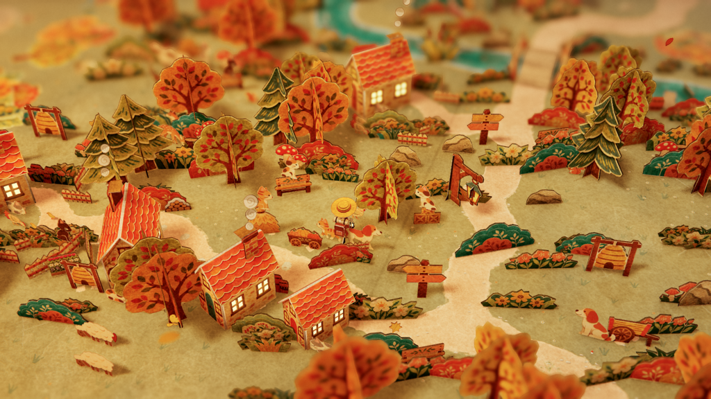
- 파일: `papertrails-popup-models.zip` (1.6MB) — 저장소 내 포함
- 제작: xikhar (Shikhar) / 라이선스: MIT / 원본: https://github.com/xikhar/papertrails

### Long Wind Poly Haven 바위 모델 9종 (glTF 1K)
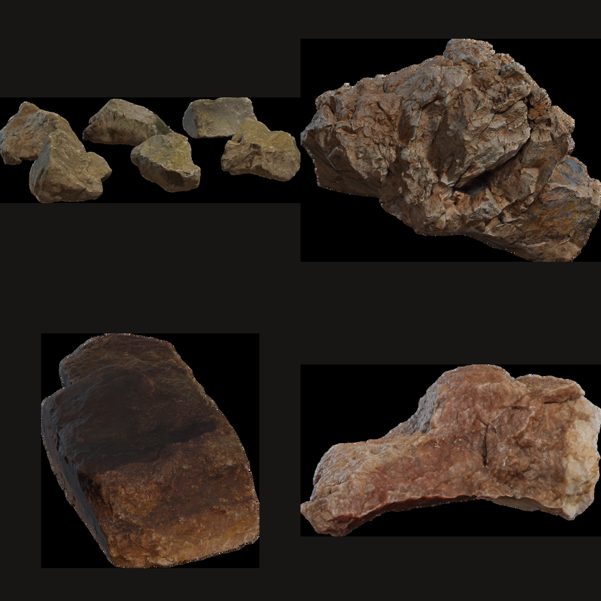
- 파일: `releases/download/long-wind-ph-rocks/long-wind-ph-rocks.zip` (27MB 분할: z01~z02+zip 3개 모두 받아 `zip -s 0 long-wind-ph-rocks.zip --out full.zip` 병합) — [릴리스 long-wind-ph-rocks](https://github.com/sigco3111/assets-3d-lowpoly-2/releases/tag/long-wind-ph-rocks)
- 제작: Poly Haven / 라이선스: CC0 / 원본: https://polyhaven.com (사용 게임: https://github.com/jbang2004/long-wind)
- 비고: gltf+bin+1K 텍스처 세트 9종. 원작 CREDITS 출처 명시, rock_07 gltf 공식 다운로드 MD5 일치 확인(2026-11-24)

### Don't Look Away 천사 석상 4종·예배당 의자 GLB (AI 생성)
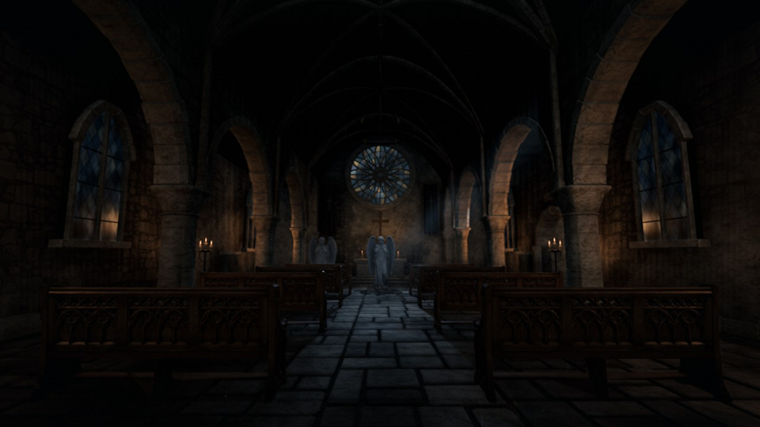
- 파일: `dont-look-away-models/dont-look-away-models.zip`
- 제작: Blendi Bylygbashi (Patch @blendi) / 라이선스: CC0 1.0 / 원본: https://patch.gg/games/blendi/dont-look-away
- 비고: 천사 4포즈(standing·reaching·lunging·weeping)와 의자 GLB 5개, meshopt 압축, 각 3.5~3.8MB

### Don't Look Away 석재·목재 PBR 텍스처 (Poly Haven CC0)
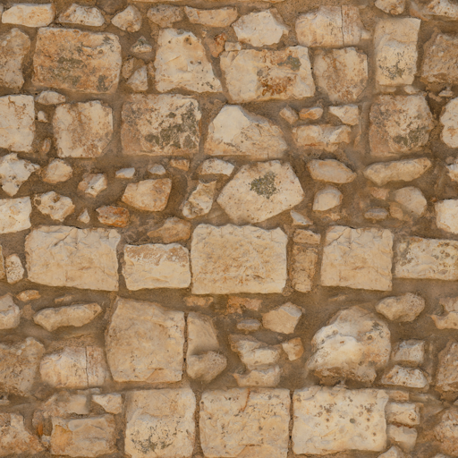
- 파일: `dont-look-away-textures/dont-look-away-textures.zip`
- 제작: Rob Tuytel, Dimitrios Savva (Poly Haven) / 라이선스: CC0 1.0 / 원본: https://patch.gg/games/blendi/dont-look-away
- 비고: Poly Haven CC0: Medieval Blocks 05·Medieval Wall 01(Rob Tuytel) color·normal·roughness JPG 6장과 Worn Planks(Dimitrios Savva) basecolor·normal·roughness WebP 3장
