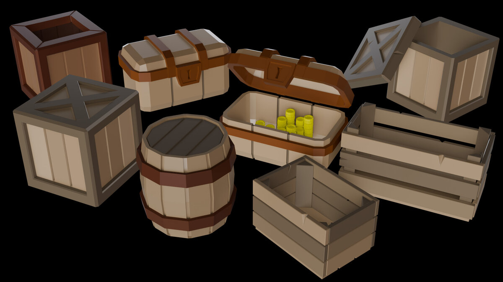
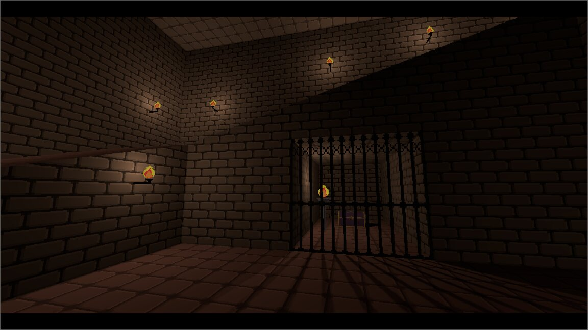

# assets-3d-lowpoly-2

3D 로우폴리 모델 2호 저장소. glTF(GLB)·OBJ 등 게임엔진/웹에서 바로 쓸 수 있는 형식의 CC0·CC-BY 팩. 1호 저장소(assets-3d-lowpoly, 약 692MB)가 700MB에 근접해 새 라운드의 3D 팩은 이 저장소에 둡니다. CC-BY 팩은 사용 시 저작자 표기 필요 (각 팩 LICENSE-SOURCE.txt에 원본 저작자·정확한 CC 버전·출처·변경 내역 기록).

## 수록 팩

### Crates Chests Coins and Barrels Collection

- 파일: `medieval_items.zip` (902.1KB) — 저장소 내 포함
- 제작: mabaci / 라이선스: CC0 / 원본: https://opengameart.org/content/crates-chests-coins-and-barrels-collection

### Dungeon interior kit

- 파일: `dungeon_interior_kit.tar.gz` (1.9MB) — 저장소 내 포함
- 제작: humble squirrel / 라이선스: CC0 / 원본: https://opengameart.org/content/dungeon-interior-kit

## 다운로드
5MB를 넘는 zip은 릴리스 첨부로 올립니다. 이번 팩은 모두 저장소에 직접 포함되어 있습니다.
