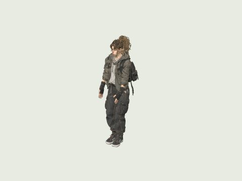
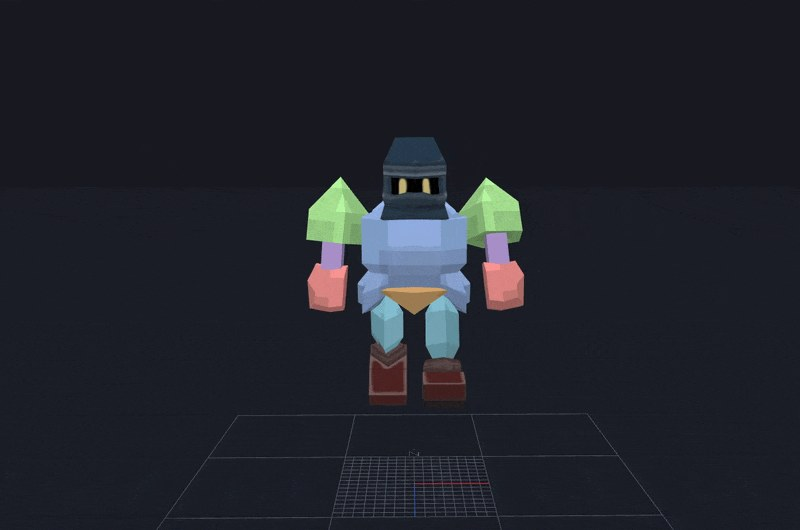

### Fjordfall Boats & Vehicles

- 파일: `fjordfall-boats-and-vehicles.zip` (1.3MB) — 저장소 내 포함
- 제작: Jonathan Maddison / 라이선스: CC BY 4.0 (AI 생성, 생성 도구 Meshy·Blender) / 원본: https://github.com/AgenticGameDevs/generated-assets

### Fjordfall Buildings

- 파일: `fjordfall-buildings.zip` (1.4MB) — 저장소 내 포함
- 제작: Jonathan Maddison / 라이선스: CC BY 4.0 (AI 생성) / 원본: https://github.com/AgenticGameDevs/generated-assets

### Fjordfall Characters

- 파일: `fjordfall-characters.zip` (2.4MB) — 저장소 내 포함
- 제작: Jonathan Maddison / 라이선스: CC BY 4.0 (AI 생성) / 원본: https://github.com/AgenticGameDevs/generated-assets

### Golem Knight

- 파일: `golem.zip` (62.8KB) — 저장소 내 포함
- 제작: Q2DENJINDREW / 라이선스: CC0 / 원본: https://opengameart.org/content/golem-knight

### Painting Pack

- 파일: `paintings_textured.zip` (5.9MB) — 릴리스 첨부
- 제작: EmoPreben / 라이선스: CC0 / 원본: https://opengameart.org/content/painting-pack

수록 팩: 19팩

### Lowpoly survival item pack

- 파일: `survival-items.zip` (279.4KB) — 저장소 내 포함
- 제작: artie31 / 라이선스: CC0 / 원본: https://opengameart.org/content/lowpoly-survival-item-pack

### LOW POLY 3D MODEL PACKS

- 파일: `model_pack_low_poly.zip` (517.6KB) — 저장소 내 포함
- 제작: byzmod3d / 라이선스: CC0 / 원본: https://opengameart.org/content/low-poly-3d-model-packs
### 3D Vehicles Pack 
- 파일: `vehicle_pack.zip` (2.6MB) — 저장소 내 포함
- 제작: mehrasaur / 라이선스: CC0 / 원본: https://opengameart.org/content/3d-vehicles-pack
### Low Poly RPG Pack 
- 파일: [릴리스 v1.0 첨부 다운로드](https://github.com/sigco3111/assets-3d-lowpoly-2/releases/download/v1.0/ultimate_rpg_items_pack_by_quaternius_0.zip) (42.6MB) — 릴리스 첨부
- 제작: quaternius / 라이선스: CC0 / 원본: https://opengameart.org/content/low-poly-rpg-pack
### LowPoly Survival Pack 
- 파일: [릴리스 v1.0 첨부 다운로드](https://github.com/sigco3111/assets-3d-lowpoly-2/releases/download/v1.0/survival_pack_-_sept_2020.zip) (5.7MB) — 릴리스 첨부
- 제작: quaternius / 라이선스: CC0 / 원본: https://opengameart.org/content/lowpoly-survival-pack

### Shadowflame Samurai (게임용 변환 바디)
- 파일: `shadowflame-samurai-game-body/7-shadowflame-samurai-game-body.zip` (4.1MB) — 저장소 내 포함
- 제작: dark_igorek / 라이선스: CC BY 4.0 / 원본: https://sketchfab.com/3d-models/shadowflame-samurai-03def921ed814b3a9de5c5962b86a45c
- 비고: Ashen Oath 인계분(i1 등록 2026-11-18), FBX→GLB 변환·텍스처 축소 적용된 게임용 바디. 표기·변경 명시 필수(팩 폴더 CREDITS.txt). 미리보기 없음. 파일명 접두 번호는 웹 업로드 방식의 한계
