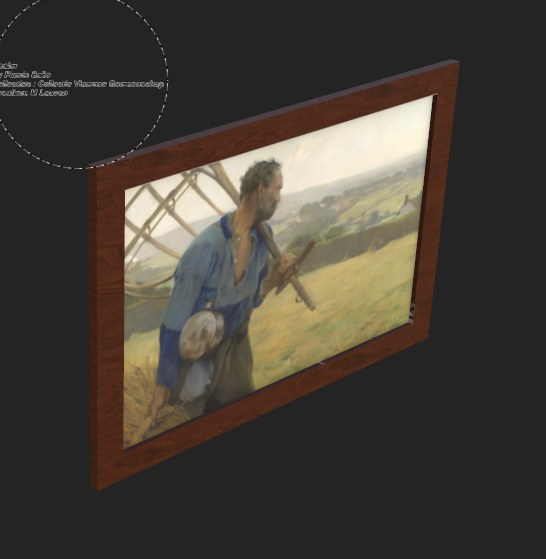
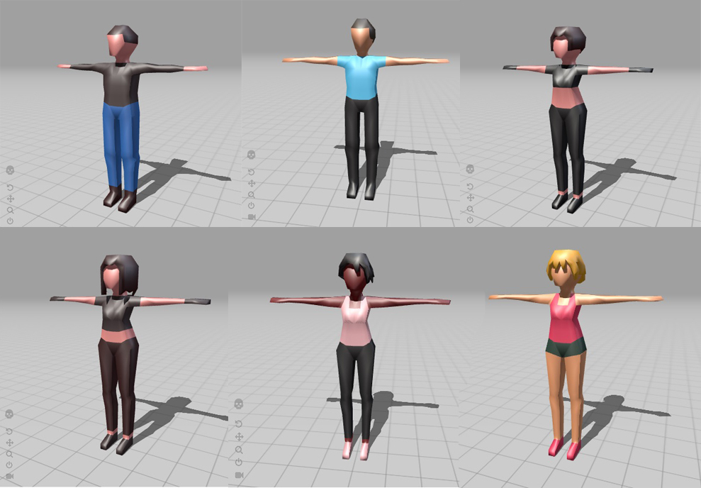

### Fjordfall Boats & Vehicles

- 파일: `fjordfall-boats-and-vehicles.zip` (1.3MB) — 저장소 내 포함
- 제작: Jonathan Maddison / 라이선스: CC BY 4.0 (AI 생성, 생성 도구 Meshy·Blender) / 원본: https://github.com/AgenticGameDevs/generated-assets

### Fjordfall Buildings

- 파일: `fjordfall-buildings.zip` (1.4MB) — 저장소 내 포함
- 제작: Jonathan Maddison / 라이선스: CC BY 4.0 (AI 생성) / 원본: https://github.com/AgenticGameDevs/generated-assets

### Fjordfall Characters

- 파일: `fjordfall-characters.zip` (2.4MB) — 저장소 내 포함
- 제작: Jonathan Maddison / 라이선스: CC BY 4.0 (AI 생성) / 원본: https://github.com/AgenticGameDevs/generated-assets

### Golem Knight

- 파일: `golem.zip` (62.8KB) — 저장소 내 포함
- 제작: Q2DENJINDREW / 라이선스: CC0 / 원본: https://opengameart.org/content/golem-knight

### Painting Pack

- 파일: `paintings_textured.zip` (5.9MB) — 릴리스 첨부
- 제작: EmoPreben / 라이선스: CC0 / 원본: https://opengameart.org/content/painting-pack

수록 팩: 23팩

### Lowpoly survival item pack

- 파일: `Survival items.zip` (279.4KB) — 저장소 내 포함
- 제작: artie31 / 라이선스: CC0 / 원본: https://opengameart.org/content/lowpoly-survival-item-pack

### LOW POLY 3D MODEL PACKS

- 파일: `model_pack_low_poly.zip` (517.6KB) — 저장소 내 포함
- 제작: byzmod3d / 라이선스: CC0 / 원본: https://opengameart.org/content/low-poly-3d-model-packs
